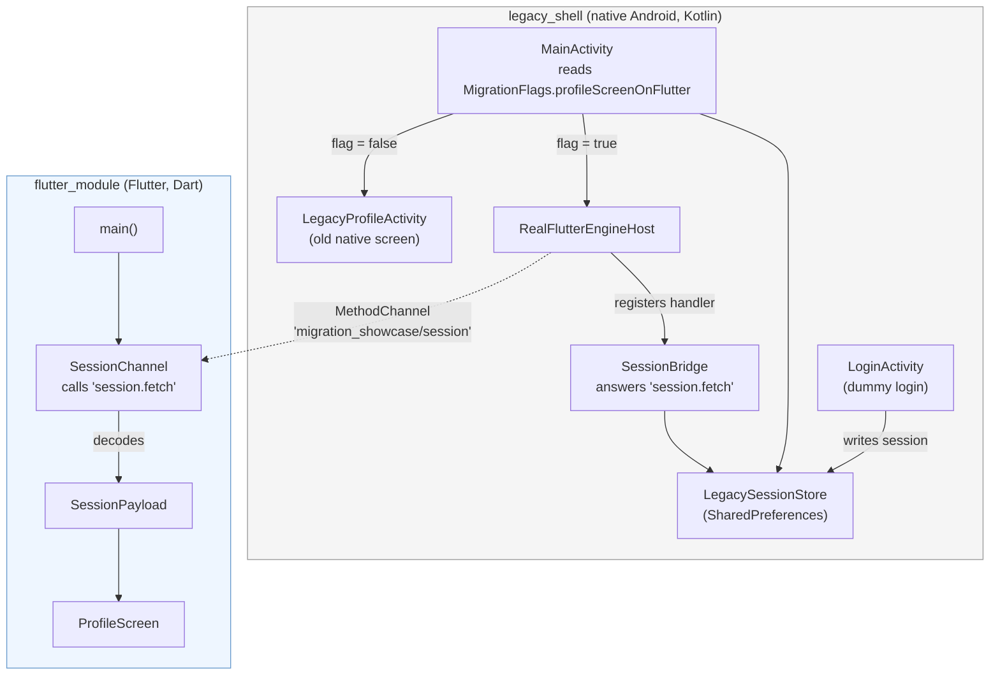
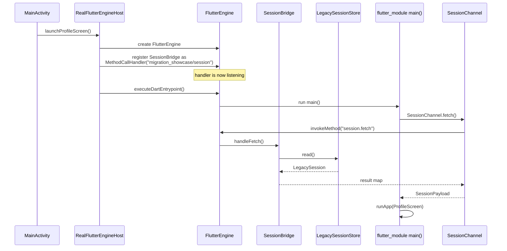

# Architecture

This repo demonstrates a gradual, screen-by-screen native→Flutter migration
(the [Strangler Fig pattern](https://martinfowler.com/bliki/StranglerFigApplication.html)):
old and new code live in the same app, one screen at a time moves over behind
a feature flag, and there is exactly one explicit crossing point for shared
state instead of ad-hoc calls scattered across the codebase.

## Module boundary

**Exactly one crossing point**: the `migration_showcase/session` `MethodChannel`,
implemented by `SessionBridge` (native) and `SessionChannel` (Flutter). See
[ADR-0001](adr/0001-single-session-bridge.md).

## The fetch sequence — why there's no race

Flutter calls native, not the other way around, and native's handler is
registered *before* the Dart entrypoint runs. This ordering is what makes the
hand-off safe without a "wait for Flutter to be ready" signal:

See [ADR-0001](adr/0001-single-session-bridge.md) for why this is a pull
(Flutter asks) rather than a push (native sends proactively).

## Feature-flag routing

`MainActivity` is the *only* place `MigrationFlags.profileScreenOnFlutter` is
read. Both implementations of the Profile screen ship in the same build;
the flag decides which one a tap on "Profile" opens. See
[ADR-0002](adr/0002-feature-flag-per-screen-routing.md).

## Testing strategy

The riskiest part of this pattern — the data contract crossing the platform
boundary — is unit-tested directly on both sides, without any UI or platform
channel mocking getting in the way of what's actually being proven:

- `legacy_shell/bridge-core`: `SessionBridgeTest` (plain JUnit, no Android
  framework dependency).
- `flutter_module`: `session_channel_test.dart` (decode logic tested directly,
  plus the full `SessionChannel.fetch()` path against a mocked platform
  channel for the success/error/malformed-response cases).

See [ADR-0003](adr/0003-bridge-tested-in-isolation.md).

## What's a deliberate simplification here

- `legacy_shell/app`'s real Flutter-engine wiring (`RealFlutterEngineHost`) is
  written against the real `io.flutter.embedding.android.*` APIs for
  reviewability, but this repo's CI doesn't attempt to build that module —
  the Flutter engine Maven artifact it needs is only produced by
  `flutter build aar` against a real local Flutter SDK. CI instead builds and
  tests `bridge-core` (the pure-Kotlin logic `SessionBridge` depends on) and
  `flutter_module` directly — see `.github/workflows/ci.yml`.
- `MigrationFlags` is a hardcoded constant here, not a real remote-config
  client. The pattern — one flag per screen, read at one call site — doesn't
  change when it's backed by a real system.
