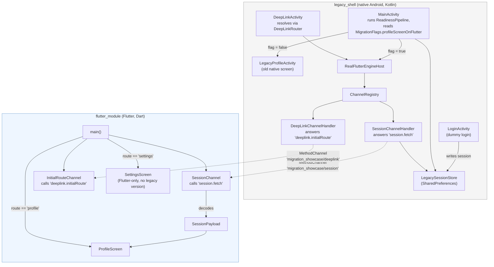
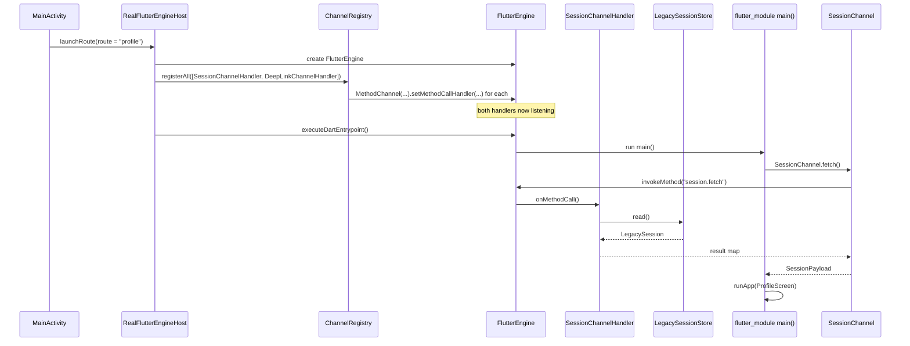

# Architecture

This repo demonstrates a gradual, screen-by-screen native→Flutter migration
(the [Strangler Fig pattern](https://martinfowler.com/bliki/StranglerFigApplication.html)):
old and new code live in the same app, one screen at a time moves over behind
a feature flag, and every crossing point between the two sides — session
data, deep-link routing, app readiness — is explicit and testable instead of
ad-hoc calls scattered across the codebase.

## Module boundary

**Two crossing points, one registration mechanism**: `migration_showcase/session`
(`SessionBridge`/`SessionChannelHandler` ↔ `SessionChannel`) and
`migration_showcase/deeplink` (`DeepLinkRouter`/`DeepLinkChannelHandler` ↔
`InitialRouteChannel`), both wired onto the engine by one `ChannelRegistry`.
See [ADR-0001](adr/0001-single-session-bridge.md),
[ADR-0005](adr/0005-deep-links-follow-the-feature-flag.md), and
[ADR-0006](adr/0006-channel-registry.md).

## The fetch sequence — why there's no race

Flutter calls native, not the other way around, and native's handlers are
registered *before* the Dart entrypoint runs. This ordering is what makes the
hand-off safe without a "wait for Flutter to be ready" signal:

See [ADR-0001](adr/0001-single-session-bridge.md) for why this is a pull
(Flutter asks) rather than a push (native sends proactively), and
[ADR-0006](adr/0006-channel-registry.md) for why registration goes through
`ChannelRegistry` instead of being hand-wired per channel.

## Feature-flag routing (manual navigation and deep links)

`MainActivity` is the only place `MigrationFlags.profileScreenOnFlutter` is
read for a manual tap. `DeepLinkActivity` reads the *same* flag — via
`DeepLinkRouter`, not a copy of the logic — when a
`migrationshowcase://open/profile` link arrives. Both implementations of the
Profile screen ship in the same build; the flag decides which one opens,
regardless of how the user got there. See
[ADR-0002](adr/0002-feature-flag-per-screen-routing.md) and
[ADR-0005](adr/0005-deep-links-follow-the-feature-flag.md).

Not every Flutter screen needs a flag: `/open/settings` always resolves to
Flutter's `SettingsScreen`, which never had a native version.

## Readiness

Before `MainActivity` shows anything, `ReadinessPipeline` runs an ordered
list of `ReadinessGate`s (`SessionPresentGate`, `MinimumAppVersionGate` in
this reference) and stops at the first one that blocks. See
[ADR-0004](adr/0004-readiness-pipeline.md).

## Testing strategy

The riskiest parts of this pattern — the data contracts crossing the
platform boundary, and the routing/readiness decisions — are unit-tested
directly, without any UI or platform-channel mocking getting in the way of
what's actually being proven:

- `legacy_shell/bridge-core` (plain JUnit, no Android framework dependency):
  `SessionBridgeTest`, `DeepLinkRouterTest`, `ReadinessPipelineTest`.
- `flutter_module`: `session_channel_test.dart` and
  `initial_route_channel_test.dart` (decode logic tested directly, plus the
  full `fetch()` path against a mocked platform channel for the
  success/error/malformed-response cases).

See [ADR-0003](adr/0003-bridge-tested-in-isolation.md).

## What's a deliberate simplification here

- `legacy_shell/app`'s real Flutter-engine wiring (`RealFlutterEngineHost`,
  `ChannelRegistry`) is written against the real
  `io.flutter.embedding.android.*` APIs for reviewability, but this repo's
  CI doesn't attempt to build that module — the Flutter engine Maven
  artifact it needs is only produced by `flutter build aar` against a real
  local Flutter SDK. CI instead builds and tests `bridge-core` (the
  pure-Kotlin logic `SessionBridge`/`DeepLinkRouter`/`ReadinessPipeline`
  depend on) and `flutter_module` directly — see `.github/workflows/ci.yml`.
- `MigrationFlags` is a hardcoded constant here, not a real remote-config
  client. The pattern — one flag per screen, read at one call site — doesn't
  change when it's backed by a real system.
- `ReadinessGate.check()` is synchronous (see
  [ADR-0004](adr/0004-readiness-pipeline.md)) — a deliberate simplification
  to stay dependency-free, not a claim that real readiness checks are never
  async.
