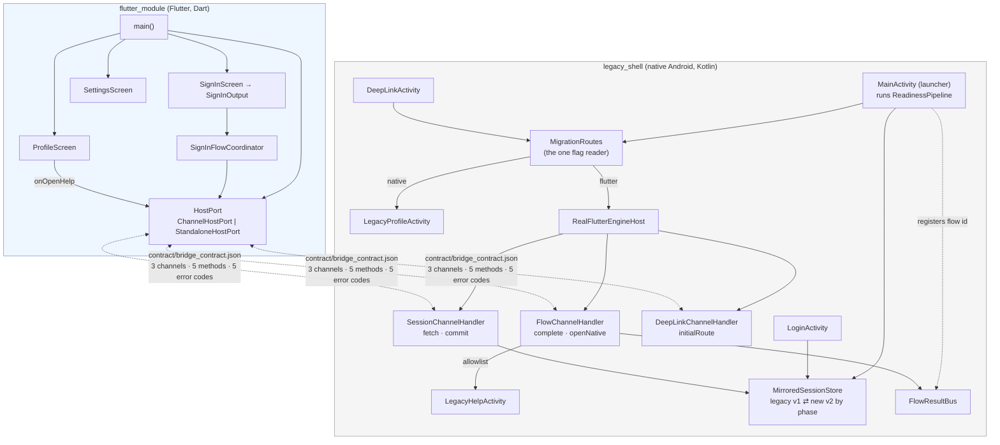
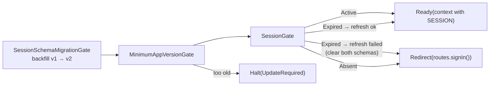
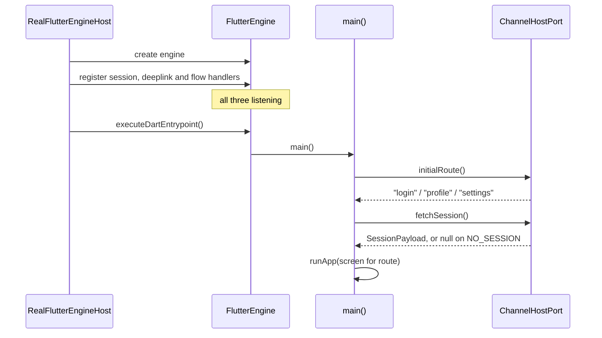
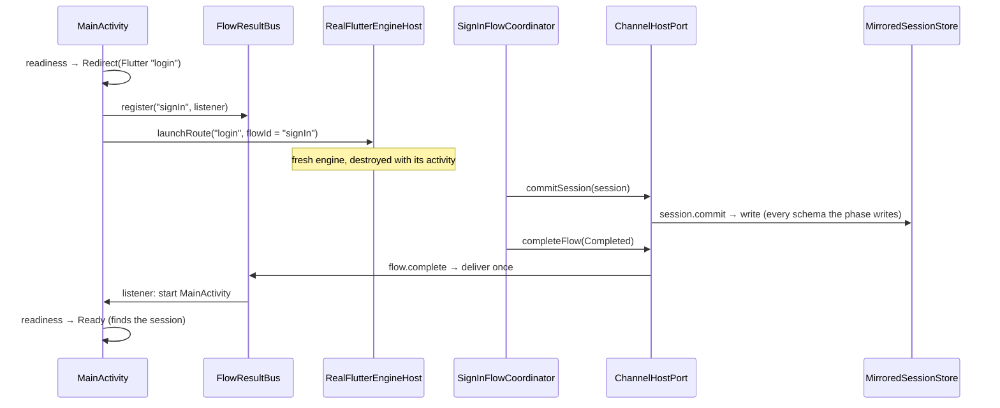

# Architecture

This repo demonstrates a gradual, screen-by-screen native→Flutter migration
(the [Strangler Fig pattern](https://martinfowler.com/bliki/StranglerFigApplication.html)).
Old and new code live in the same app, and each screen moves over behind a
feature flag. Every crossing point between the two sides is explicit, typed and
tested: session data in both directions, start routing, flow results, and
navigation back to native.

## Module boundary

`bridge-core` (pure Kotlin, no Android) holds everything with a decision in it:
the stores and migrator, the codecs, `SessionBridge`, `MigrationRoutes`,
`DeepLinkRouter`, readiness, `FlowResultBus` and `NativeRoutes`. `:app` only
adapts it to Activities and engines.

## Startup: readiness decides, typed

A gate that throws becomes `Halt(Internal)`. `MainActivity` handles `Ready`,
`Redirected` and `Halted` with one exhaustive `when` and no string comparison.
See [ADR-0012](adr/0012-readiness-gates-return-typed-outcomes.md).

## No race on the way in

Flutter calls native, and native registers every handler **before** the Dart
entrypoint runs ([ADR-0001](adr/0001-single-session-bridge.md),
[ADR-0006](adr/0006-channel-registry.md)):

## A Flutter flow, end to end (sign-in)

With `loginScreenOnFlutter` on, signing in is a round trip that starts and ends
in native readiness ([ADR-0008](adr/0008-flutter-writes-back-through-one-commit.md),
[ADR-0009](adr/0009-flows-return-typed-results.md)):

If the commit fails, the flow isn't completed and the screen shows the error
code. Cancel and system back report `Cancelled`.

## Storage migration

`MirroredSessionStore` moves the session from the legacy flat keys to a
versioned v2 document in three release-gated phases: `EXPAND` (legacy
canonical), `MIGRATE` (new canonical, legacy still written) and `CONTRACT` (new
only). It reads with migrate-on-read and always clears both sides. See
[ADR-0007](adr/0007-session-storage-expand-migrate-contract.md).

## Routing: one flag reader

`MigrationRoutes` is the only code that reads `MigrationFlagSet`. The Profile
button, `DeepLinkRouter` and `SessionGate`'s sign-in redirect all get a
`StartDestination` from it, so they cannot disagree. `Context.open(destination)`
in `:app` is the only place that turns one into an Activity or an engine
([ADR-0002](adr/0002-feature-flag-per-screen-routing.md),
[ADR-0005](adr/0005-deep-links-follow-the-feature-flag.md)).

Going the other way, Flutter can open only what `NativeRoutes.ALLOWED` lists.
That crossing is annotated `@TemporaryCrossing(removeWhen = …)`
([ADR-0010](adr/0010-native-navigation-is-an-allowlisted-temporary-crossing.md)).

## The contract

`contract/bridge_contract.json` defines the version, channels, method → channel
mapping, payload keys, flow statuses and error codes. Kotlin and Dart each
mirror it and each test against the file itself. Errors cross as stable codes
and arrive in Dart as `BridgeException(BridgeErrorCode)`. See
[ADR-0011](adr/0011-one-versioned-bridge-contract.md).

## Further reading

- [Testing strategy](testing-strategy.md): parity vs revamp, the three-box
  triage, and which test guards which risk.
- [Where objects get created](di-decision-tree.md): the DI decision tree, and
  why there's no container here.

## Deliberate simplifications

- CI doesn't build `:app`. The Flutter engine artifact it needs comes from
  `flutter build aar` against a local SDK. CI builds and tests `bridge-core`
  and `flutter_module`, which hold all the logic.
- `MigrationFlags.current` is a constant, the migration phase is a constant,
  and `FakeTokenRefresher` always succeeds. The patterns don't change when
  these are backed by remote config and a real auth server.
- Gates are synchronous, and `FlowResultBus` lives in process memory. Both are
  discussed in their ADRs.
