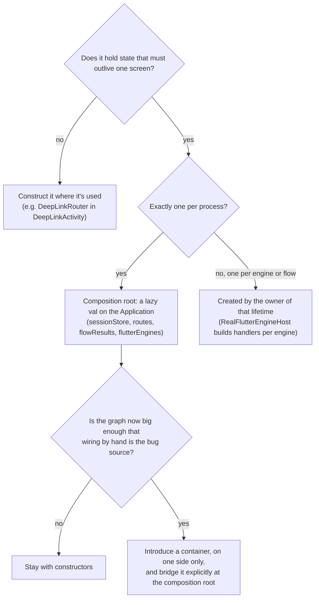

# Where does an object get created?

Migrations tend to import a DI framework into the shell "because the new code
uses one", and then fight two containers. The rule here is to pick the
**smallest mechanism that owns the object's lifetime**, in this order:

Applied in this repo:

- **Per use**: `DeepLinkRouter`, `ReadinessPipeline` and its gates, and
  `SessionBridge`. They're cheap and stateless, and constructing them at the
  call site keeps their dependencies visible.
- **Per process** (`LegacyShellApplication`): the `MirroredSessionStore` (both
  schemas behind it), `MigrationRoutes`, the `FlowResultBus` and the engine
  host. These must be shared, because two stores in different phases or two
  result buses would split state.
- **Per engine**: the channel handlers. Each engine gets its own set, because a
  flow's handler carries that flow's id ([ADR-0009](adr/0009-flows-return-typed-results.md)).
- **Flutter side**: one `HostPort`, chosen in `main()` by `HOST_MODE` and passed
  down by constructor. Screens receive callbacks, not the port.

No container is used, because the graph is a dozen objects. The decision point
that would change that is in the diagram: when hand wiring itself causes bugs,
not when the object count feels large. Even then the container stays on one
side. The two runtimes meet only through the contract
([ADR-0011](adr/0011-one-versioned-bridge-contract.md)), never through shared
DI.
